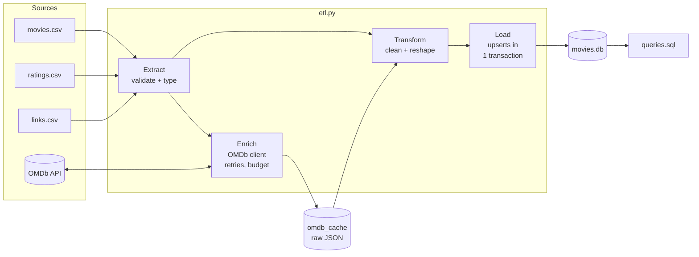
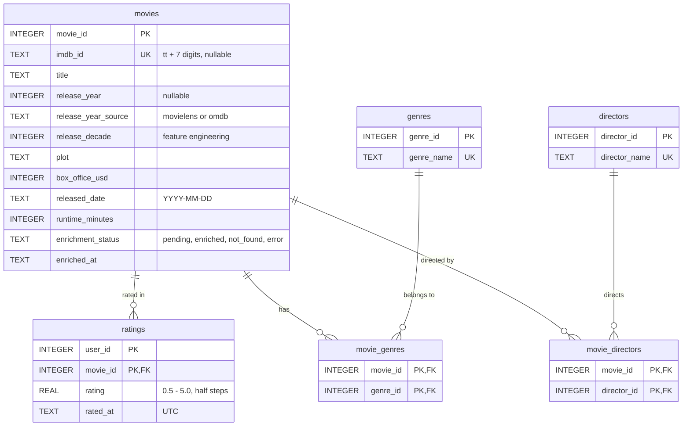

# Movie Data Pipeline (MovieLens + OMDb -> SQLite)

A small, tested ETL pipeline built for the tsworks Data Engineering take-home assignment.
It ingests the MovieLens "small" dataset, enriches movies with details from the OMDb API,
cleans and models the data in SQLite, and answers four analytical questions in SQL.

**Author:** Saranya K

---

## Contents

1. [Overview](#1-overview)
2. [Quick start](#2-quick-start)
3. [Architecture](#3-architecture)
4. [Database design](#4-database-design)
5. [ETL pipeline in detail](#5-etl-pipeline-in-detail)
6. [OMDb API strategy](#6-omdb-api-strategy)
7. [Idempotency](#7-idempotency)
8. [Results: the four questions](#8-results-the-four-questions)
9. [Testing](#9-testing)
10. [Design choices](#10-design-choices)
11. [Assumptions](#11-assumptions)
12. [Challenges and how they were solved](#12-challenges-and-how-they-were-solved)
13. [Limitations](#13-limitations)
14. [Future improvements and scaling](#14-future-improvements-and-scaling)
15. [Project structure](#15-project-structure)

---

## 1. Overview

| | |
|---|---|
| **Sources** | MovieLens `ml-latest-small` (`movies.csv`, `ratings.csv`, `links.csv`) and the OMDb API |
| **Output** | `movies.db` (SQLite): movies, ratings, genres, directors and their relationships |
| **Main script** | `etl.py`: Extract -> Enrich (OMDb) -> Transform -> Load, in one command |
| **Questions** | `queries.sql`, run with `python scripts/run_queries.py` |
| **Tests** | 196 automated tests (`pytest`); no test calls the real API |
| **Key properties** | Idempotent (re-runs change nothing), resumable API enrichment, single-transaction load |

What happens when you run `python etl.py`:

1. The three CSV files are validated (file exists, required columns, types, value ranges).
2. Movies without a cached OMDb result are looked up, **most-rated first**, within a configurable
   daily request budget. Every response is cached in the database immediately.
3. MovieLens data and cached OMDb data are cleaned and combined (years, decades, genres,
   directors, box office, dates, runtime, timestamps).
4. Everything is upserted into SQLite in **one transaction**, then integrity checks run.

---

## 2. Quick start

### Requirements

- Python **3.11 or newer** (developed and tested with 3.12.4; pandas 3 needs 3.11+)
- SQLite **3.37 or newer** (bundled with Python 3.11+; checked by a test)
- A free OMDb API key: <https://www.omdbapi.com/apikey.aspx>

### Setup (Windows PowerShell)

```powershell
git clone https://github.com/SaranyaK-0709/movie-data-pipeline.git
cd movie-data-pipeline
py -3.12 -m venv .venv
.\.venv\Scripts\Activate.ps1
python -m pip install -r requirements.txt
Copy-Item .env.example .env        # then edit .env and set OMDB_API_KEY
```

On macOS/Linux use `python3 -m venv .venv`, `source .venv/bin/activate` and `cp .env.example .env`.

### Get the data

Download `ml-latest-small.zip` from <https://grouplens.org/datasets/movielens/latest/> and copy
`movies.csv`, `ratings.csv` and `links.csv` into `data/`. Exact steps and file checksums are in
[`data/README.md`](data/README.md). The CSV files are not committed to this repository.

### Run

```powershell
python etl.py                          # full pipeline (uses up to 950 OMDb calls)
python scripts/run_queries.py          # answers to the four questions
python -m pytest                       # all tests (no network access needed)
```

Useful options:

| Command | Purpose |
|---|---|
| `python etl.py --skip-api` | Rebuild the database from cached OMDb data only (0 API calls) |
| `python etl.py --max-api-calls 20` | Small trial run |
| `python etl.py --help` | All options (`--data-dir`, `--db`, `--log-dir`, `--log-level`) |
| `python scripts/inspect_cache.py 20` | OMDb cache status, rating coverage and the 20 most recent entries |
| `python scripts/run_queries.py --all` | Show every result row (Q1 and Q4 are long) |
| `python scripts/profile_data.py` | Data-profiling report on the raw CSV files |

Logs are written to the console and to `logs/pipeline.log` (UTF-8).
Exit codes: `0` success, `1` pipeline error, `2` configuration error, `130` interrupted.

---

## 3. Architecture



The key design idea: **raw API responses are stored separately from the modelled tables.**
`omdb_cache` makes enrichment resumable and auditable; the modelled tables are rebuilt from
the CSV files plus the cache on every run, so every run produces the same result.

---

## 4. Database design

Defined in [`schema.sql`](schema.sql) and applied automatically by `etl.py`
(`CREATE ... IF NOT EXISTS`, so it is safe on every run).



A seventh table, `omdb_cache` (one row per movie: status, raw JSON, attempts, timestamps), holds
the Extract-stage API results and intentionally has no foreign key to `movies`.

| Decision | Reason (from profiling the real data) |
|---|---|
| `movie_id` as key, never the title | 5 pairs of identical titles are different films (e.g. two "War of the Worlds (2005)") |
| Genres in `genres` + `movie_genres` | Up to 10 genres per movie; a pipe-separated string cannot be grouped or joined |
| Directors in `directors` + `movie_directors` | OMDb lists co-directors in one string; 104 extra links among the first 969 enriched films |
| Ratings key `(user_id, movie_id)` | 0 duplicate pairs in the source; the key makes duplicates impossible |
| `release_year` nullable, with its source | 12 titles have no year; MovieLens and OMDb sometimes disagree |
| `STRICT` tables + `CHECK` constraints | Wrong types and impossible values fail loudly instead of being stored |
| Indexes on `ratings(movie_id)`, `movie_genres(genre_id)`, `movie_directors(director_id)`, `movies(release_year)` | Support the joins and groupings in `queries.sql` |
| No `users` table | MovieLens has no user attributes beyond the ID |
| Dates as ISO-8601 text (UTC) | SQLite has no DATE type; ISO text sorts correctly and works with date functions |

SQLite enforces foreign keys only after `PRAGMA foreign_keys = ON`; `etl.py` sets it on every
connection, and a test checks it.

---

## 5. ETL pipeline in detail

### Extract (`extract_*` functions)

- Checks each file exists and has the required columns; a missing file or column stops the
  pipeline with a clear message (exit code 1).
- Reads every column **as text first**, then converts. A bad value (for example `abc` in an ID
  column) drops only that row and is logged with its original value.
- Only empty cells count as missing (`keep_default_na=False`), so a title such as `NA` stays text.
- `imdbId` is kept as text and formatted as `tt0114709` (leading zeros preserved).
- Duplicate `(userId, movieId)` ratings keep the most recent; ratings for unknown movies are removed.

### Enrich (OMDb)

See [section 6](#6-omdb-api-strategy).

### Transform (`transform`)

| Field | Raw example | Stored value |
|---|---|---|
| Release year | `Toy Story (1995)` | `1995` (MovieLens title first; OMDb `Year` only when the title has none) |
| Decade (feature) | `1995` | `1990` |
| Genres | `Adventure\|Animation` | 2 rows in `movie_genres`; `(no genres listed)` -> none |
| Directors | `Lana Wachowski, Lilly Wachowski` | 2 rows in `movie_directors` |
| Box office | `$292,587,330` | `292587330` |
| Released | `16 Jul 2010` | `2010-07-16` |
| Runtime | `148 min` | `148` |
| Any OMDb `N/A` | `N/A` | `NULL` |
| Rating time | `964982703` | `2000-07-30 18:45:03` (UTC) |

Unparseable values become `NULL`, never a guess: a missing box-office figure is better than a wrong one.

### Load (`load`)

One transaction (`with conn:`): upsert movies -> sync genres and links -> sync directors and
links -> upsert ratings -> `PRAGMA foreign_key_check`. Any error rolls back everything.
After commit, `PRAGMA integrity_check` runs and row counts before/after are logged.

---

## 6. OMDb API strategy

**Matching (most reliable first)**

1. **By IMDb ID** from `links.csv` (`?i=tt0114709`): exact, and available for all 9,742 movies.
2. **Fallback, only if the ID is unknown to OMDb or missing:** cleaned title + year
   (`American President, The (1995)` -> `t=The American President&y=1995`). The result is
   accepted only if OMDb's year is within +/- 1 of the MovieLens year. Without a year, no title
   search is made, because it could attach the wrong film (there are four different
   "Miserables, Les" in the data).

**Error handling**

| Situation | Behaviour |
|---|---|
| `{"Response": "False", "Error": "Movie not found!"}` with **HTTP 200** | `not_found`; success is judged by the JSON body, not the status code |
| Timeout, connection error, HTTP 5xx, malformed JSON | Retried up to 3 times (backoff 1 s, 2 s), then `error` |
| `error` on later runs | Retried, at most 3 runs in total |
| Invalid key (HTTP 401) | Enrichment stops at once; cached progress is kept |
| "Request limit reached!" or HTTP 429 | Enrichment stops; the next run resumes |
| Per-run budget (`--max-api-calls`, default 950) | Never exceeded; every retry counts against it |
| API key in an error message | Replaced by `***` before logging |

**Resumability:** each result is committed to `omdb_cache` immediately. An interrupted or
budget-limited run loses nothing; the next run skips every movie with a final result.

**Daily quota:** the free key allows 1,000 requests/day, and the dataset has 9,742 movies (at
least 10 days for full coverage). Movies are therefore enriched **most-rated first**. Profiling
showed the 950 most-rated movies (about 10% of movies) account for **59.4% of all ratings**.
After two daily batches (1,918 movies), the measured coverage is **76.7% of all ratings**
(`python scripts/inspect_cache.py` prints the current figure).

---

## 7. Idempotency

Running the pipeline any number of times never creates duplicates. Four layers guarantee it:

1. **Keys:** primary keys on `movie_id`, `(user_id, movie_id)` and every link pair; unique names.
2. **Upserts:** `INSERT ... ON CONFLICT DO UPDATE` instead of plain inserts.
3. **Change detection:** `WHERE (current columns) IS NOT (new columns)` skips unchanged rows.
   `IS NOT` treats two NULLs as equal, unlike `!=`.
4. **Link synchronisation:** missing links are added and links the source no longer has are removed.

**Evidence from the real data** (second consecutive run of `python etl.py --skip-api`):

```text
Load: movies written 0 | ratings written 0 | genre links +0/-0 | director links +0/-0
Load: movies              9742 rows (before 9742, change +0)
Load: genres                19 rows (before 19, change +0)
Load: movie_genres       22050 rows (before 22050, change +0)
Load: directors            509 rows (before 509, change +0)
Load: movie_directors     1073 rows (before 1073, change +0)
Load: ratings           100836 rows (before 100836, change +0)
Load: no changes - the database already matched the source (idempotent re-run)
Database checks: integrity_check=ok | foreign key violations=0
```

The test `test_whole_pipeline_run_twice_gives_identical_database` runs the full pipeline twice
and compares every table row by row.

---

## 8. Results: the four questions

From `python scripts/run_queries.py` on the database built on **25 Oct 2026**
(1,918 of 9,742 movies enriched, covering 76.7% of all ratings; see [Limitations](#13-limitations)).
Each query in [`queries.sql`](queries.sql) documents its interpretation in a comment.

**Q1. Which movie has the highest average rating?**
Literal answer: a **296-way tie at 5.0**. 289 of these movies have a single rating and 7 have
two. All tied movies are returned (none is silently picked by `LIMIT 1`).

**Q1b (optional, not in the assignment). Highest average among movies with >= 50 ratings**
(threshold fixed before looking at results; 450 movies qualify):

| # | Movie | Avg | Ratings |
|---|---|---|---|
| 1 | Shawshank Redemption, The (1994) | 4.429 | 317 |
| 2 | Godfather, The (1972) | 4.289 | 192 |
| 3 | Fight Club (1999) | 4.273 | 218 |
| 4 | Cool Hand Luke (1967) | 4.272 | 57 |
| 5 | Dr. Strangelove or: How I Learned to Stop Worrying and Love the Bomb (1964) | 4.268 | 97 |

**Q2. Top 5 genres by average rating** (average of every individual rating in the genre):

| # | Genre | Avg rating | Ratings | Movies | Avg of movie averages |
|---|---|---|---|---|---|
| 1 | Film-Noir | 3.9201 | 870 | 85 | 3.6705 |
| 2 | War | 3.8083 | 4,859 | 381 | 3.5717 |
| 3 | Documentary | 3.7978 | 1,219 | 438 | 3.7817 |
| 4 | Crime | 3.6583 | 16,681 | 1,196 | 3.3018 |
| 5 | Drama | 3.6562 | 41,928 | 4,349 | 3.4209 |

The definition matters: weighting each movie equally (last column) would put Documentary first.
Film-Noir leads on a relatively small sample (870 ratings).

**Q3. Director with the most movies:** **Steven Spielberg, 20 movies**, counted over the
1,918 enriched movies (it was 17 when 969 movies were enriched). Co-directed films count for each director. This answer covers the enriched
subset only and can change as enrichment continues.

**Q4. Average rating of movies released each year:** 106 release years (1902-2018); run
`python scripts/run_queries.py --all` for the full table. Early years rest on very few ratings
(for example 1903, 1908, 1915 and 1917 each have one movie with 1-2 ratings), so `n_ratings`
and `n_movies` are shown next to every average.

---

## 9. Testing

```powershell
python -m pytest            # 196 tests
python -m pytest -v         # one line per test
```

| File | Tests | Covers |
|---|---|---|
| `test_schema.py` | 35 | Tables, constraints, foreign keys, STRICT types, duplicate rejection |
| `test_extract.py` | 35 | Valid CSVs, missing files, missing columns, bad rows, duplicates, config, key never logged |
| `test_enrich.py` | 50 | OMDb success, not found (HTTP 200), timeouts, 5xx, malformed JSON, invalid key, rate limit, budget, retries, title fallback, resume, key redaction |
| `test_transform.py` | 54 | Every parser with real values, year fallback, N/A -> NULL, genres, co-directors, schema acceptance |
| `test_load.py` | 13 | First load, NULLs and SQL types, idempotency (twice, row by row), updates, link sync, rollback, integrity |
| `test_queries.py` | 9 | Each query against a hand-calculated dataset, including ties |

- **No test touches the real API:** a fake HTTP session supplies responses, and `tests/conftest.py`
  blocks real network access for every test.
- Every test uses temporary files and databases; the real `data/` and `movies.db` are never touched.

---

## 10. Design choices

- **SQLite + plain `sqlite3`:** no server to install, so a reviewer can run everything at once;
  SQL stays visible in `schema.sql` and `queries.sql`. SQLAlchemy would add a layer without a benefit here.
- **pandas** for CSV handling and vectorised cleaning; **requests** for HTTP; **python-dotenv** for the key.
- **One `etl.py` file** with clearly separated, documented stages: easy to read top to bottom.
- **Pinned direct dependencies** in `requirements.txt` (pandas 3 changed defaults compared to pandas 2).
- **Configuration** through command-line options and `.env`; the API key is never hard-coded,
  logged or committed.

## 11. Assumptions

- Each MovieLens `(userId, movieId)` pair is one rating; if repeated, the latest timestamp wins.
- The release year comes from the MovieLens title (original release); OMDb's year is used only
  when the title has none. Example of a disagreement: Schindler's List is 1993 in MovieLens and 1994 in OMDb.
- `(no genres listed)` means "unknown", not a genre.
- Q1 and Q2 average individual ratings. Q4 groups by release year, not by rating year.
- Movies removed from the source CSV are not deleted from the database (insert/update load).

## 12. Challenges and how they were solved

| Challenge | Solution |
|---|---|
| OMDb returns **HTTP 200 for "Movie not found!"** (found by testing the API before coding) | The client decides success from the `Response` field, not the status code |
| **Free API limit (1,000/day) vs 9,742 movies** | Most-rated-first order, per-run budget, resumable cache, honest coverage reporting |
| **Titles do not match OMDb** (`American President, The`, `Seven (a.k.a. Se7en)`) | Look up by IMDb ID; title fallback normalises titles and checks the year |
| **Identical titles for different films** (5 pairs; four "Miserables, Les") | `movie_id` as key; year check on title matches |
| **Leading zeros in `imdbId`** (`0114709`) | Read as text, format as `tt` + 7 digits |
| **Accented titles looked corrupted** in a profiling report (accented letters printed as wrong symbols) | Traced to a Windows console encoding mismatch, not the data; logs are written explicitly as UTF-8 |
| **Co-directors in one string** | Split into `movie_directors` rows |
| **Transient API failures** | Retries with backoff; one real retry occurred during the 950-call batch and succeeded |
| **OMDb server-side error** ("Error getting data." for Confessions of a Dangerous Mind, 2002) | Stored as `error`, not `not_found`, so it is retried on later runs (at most 3) instead of being wrongly marked as missing |
| **pandas 3 behaviour changes** (copy-on-write, new string type) | Code written and tested for pandas 3.1; versions pinned |
| **Tests could have created a real database / called the API** (found during review) | `main()` tests use temporary paths; `conftest.py` blocks all real network access |

## 13. Limitations

- **Partial enrichment.** As of 25 Oct 2026, after two daily batches, 1,918 of 9,742 movies
  (19.7%) are enriched. Because the most-rated movies go first, they cover **76.7% of all
  ratings** (measured; profiling predicted 76.5%). Q3 (directors), box office and plots
  therefore cover the enriched subset only. Running `python etl.py` once a day continues
  automatically from the cache.
- One movie currently has status `error` (OMDb returned "Error getting data."); it is retried
  automatically on the next runs.
- Not-enriched movies keep `enrichment_status = 'pending'` and NULL OMDb fields.
- The rate-limit response ("Request limit reached!") is handled from its documented text but
  was not observed during development.
- Averages for small groups (early release years, small genres) are statistically weak.
- The load inserts and updates; it does not delete movies or ratings that disappear from the source.

## 14. Future improvements and scaling

- **Scheduling:** a daily scheduled run (cron, or an orchestrator such as Airflow) to finish
  enrichment and pick up new data.
- **Larger data:** move from SQLite to PostgreSQL; load with bulk `COPY` and staging tables;
  process the 33M-rating MovieLens dataset in chunks.
- **Faster enrichment:** a paid OMDb key, or concurrent requests with a rate limiter.
- **Data quality:** minimum-sample rules for averages (e.g. Bayesian/weighted ratings);
  data-quality checks as a pipeline stage; alerts on anomalies.
- **Operations:** structured (JSON) logs, run history table, metrics, Docker image, CI running the tests.
- **Source deletions:** soft-delete or full-refresh mode for removed movies/ratings.

## 15. Project structure

```text
movie-data-pipeline/
|-- etl.py                  # the pipeline: Extract -> Enrich -> Transform -> Load
|-- schema.sql              # CREATE TABLE statements (applied automatically)
|-- queries.sql             # the four analytical questions (+ optional Q1b)
|-- README.md
|-- requirements.txt        # pinned direct dependencies
|-- pytest.ini
|-- .env.example            # copy to .env and add your OMDb key (never commit .env)
|-- .gitignore / .gitattributes
|-- data/
|   `-- README.md           # download instructions + checksums (CSV files not committed)
|-- scripts/
|   |-- profile_data.py     # data profiling report
|   |-- inspect_cache.py    # view cached OMDb results
|   `-- run_queries.py      # run queries.sql and print tables
`-- tests/                  # 196 pytest tests + conftest.py (network blocked)
```

Generated (not committed): `movies.db`, `logs/pipeline.log`, the CSV files in `data/`.